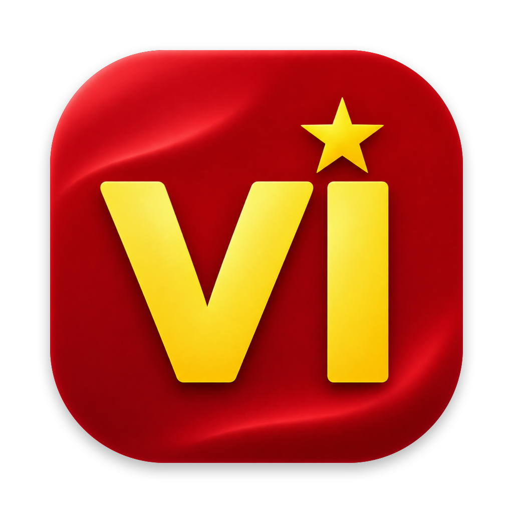

# VietIME



Bộ gõ tiếng Việt kiểu Telex cho macOS, chạy trên menu bar. Viết bằng Swift thuần, không cần Xcode, không phụ thuộc thư viện ngoài.

## Tính năng

- **Telex không cần đúng thứ tự**: cả từ được tính lại từ các phím thô sau mỗi lần gõ, nên `tieengs`, `tiengse`, `tieesng` đều ra `tiếng`.
- **Gõ lẫn tiếng Anh**:
  - Tự trả về từ tiếng Anh: gõ `google` rồi bấm cách thì ra `google`, không ra `gôgle`.
  - Hiểu gõ đúp kiểu Unikey: `pussh` → `push`, `classs` → `class`, dùng từ điển tiếng Anh của macOS để quyết định.
  - Danh sách từ tiếng Anh riêng của bạn, cùng một bộ từ có sẵn (`of`, …) mà Telex hay đổi nhầm.
  - Tuỳ chọn hiện tiếng Anh ngay khi đang gõ, không chờ dấu cách.
- **Kiểu đặt dấu**: kiểu mới (`hoà`, `khoẻ`, `thuý`) hoặc kiểu cũ (`hòa`, `khỏe`, `thúy`).
- **Chế độ theo từng app**: mỗi app có thể là *Tự động* (nhớ trạng thái lần trước), *Luôn tiếng Việt*, *Luôn tiếng Anh* hoặc *Tắt* (không đụng vào phím nào).
- **Phím tắt bật/tắt** tuỳ chỉnh được, mặc định `⌃⇧Space`. Khi chuyển sẽ hiện một nhãn nhỏ VI/EN dưới menu bar.
- **Phát hiện Secure Input**: khi một ô mật khẩu hay app khác bật Secure Event Input, macOS chặn bộ gõ. VietIME báo cho bạn biết và chỉ ra app đang giữ nó.
- **Chạy được với ô tự hoàn thành** của trình duyệt và Spotlight (`ho` → `ho@gmail.com`).
- Mục **Thử gõ** trong Cài đặt cho bạn gõ phím thô và xem VietIME xử lý từng từ ra sao, kèm lý do.

## Yêu cầu

- macOS 13 Ventura trở lên
- Swift 5.10+ (Command Line Tools là đủ: `xcode-select --install`)

## Cài đặt

```sh
git clone https://github.com/namchibi/VietIME.git
cd VietIME

# Chỉ cần làm một lần: tạo chứng chỉ ký code cục bộ
./setup-signing.sh

# Build ra build/VietIME.app
./make-app.sh
open build/VietIME.app
```

Lần chạy đầu, VietIME sẽ xin quyền **Trợ năng (Accessibility)** tại *System Settings → Privacy & Security → Accessibility*. App cần quyền này để nhận phím gõ và thay bằng chữ có dấu. Cấp quyền xong là bộ gõ tự chạy, không cần mở lại app.

> **Vì sao cần `setup-signing.sh`?** Nếu app chỉ được ký ad-hoc, mỗi lần build lại macOS sẽ coi đó là một app mới và thu hồi quyền Accessibility. Script này tạo một chứng chỉ tự ký tên "VietIME Dev" trong một keychain riêng (`~/Library/Keychains/vietime-dev.keychain-db`), nhờ đó quyền được giữ qua các lần build. Bật "Mở VietIME khi đăng nhập" cũng cần bản app đã ký.

## Phát triển

```sh
swift build          # build bản debug
swift test           # chạy test của TelexEngine
```

Xem log trực tiếp:

```sh
log stream --predicate 'subsystem == "dev.local.vietime"'
```

### Cấu trúc

| Thư mục | Nội dung |
|---|---|
| `Sources/TelexEngine` | Engine Telex thuần, không phụ thuộc AppKit: chuyển phím thô thành chữ Việt (`Telex.swift`), kiểm tra âm tiết hợp lệ (`Spelling.swift`), kiểu đặt dấu, và tính chuỗi backspace + text cần gửi (`TypingBuffer.swift`). |
| `Sources/VietIME` | App menu bar: bắt phím qua `CGEventTap` (`KeyHandler.swift`), theo dõi app đang mở, từ điển tiếng Anh, Secure Input, menu, onboarding, toast. |
| `Sources/VietIME/SettingsWindow` | Cửa sổ Cài đặt (SwiftUI) với các tab Chung, Gõ phím, Từ tiếng Anh, Ứng dụng. |
| `Tests/TelexEngineTests` | Unit test cho engine. |
| `Icon` | Icon app: ảnh gốc `source.png`; chạy `swift Icon/make-icon.swift` để cắt viền, đặt theo khung icon macOS và tạo lại `AppIcon.png` + `AppIcon.icns`. |

### Cách hoạt động

`KeyHandler` cài một `CGEventTap` để chặn phím gõ. Với mỗi phím, engine tính lại cả từ hiện tại, rồi `TypingBuffer` so với những gì đang hiện trên màn hình. App gửi đủ số backspace để xoá phần khác nhau, sau đó gửi phần chữ mới. Mỗi ký tự đi thành một sự kiện phím riêng, vì gộp nhiều ký tự vào một sự kiện sẽ bị một số app làm rơi chữ.

Cài đặt được lưu trong `UserDefaults`, domain `dev.local.vietime`.
